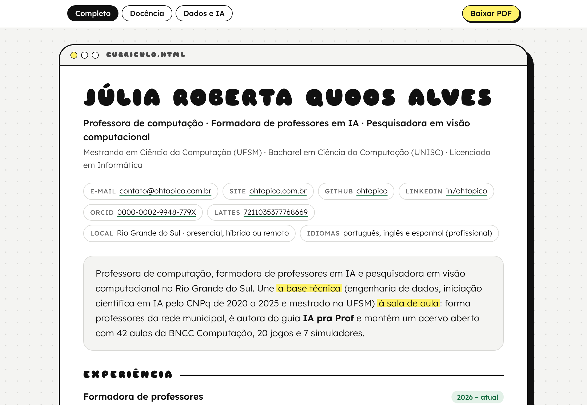
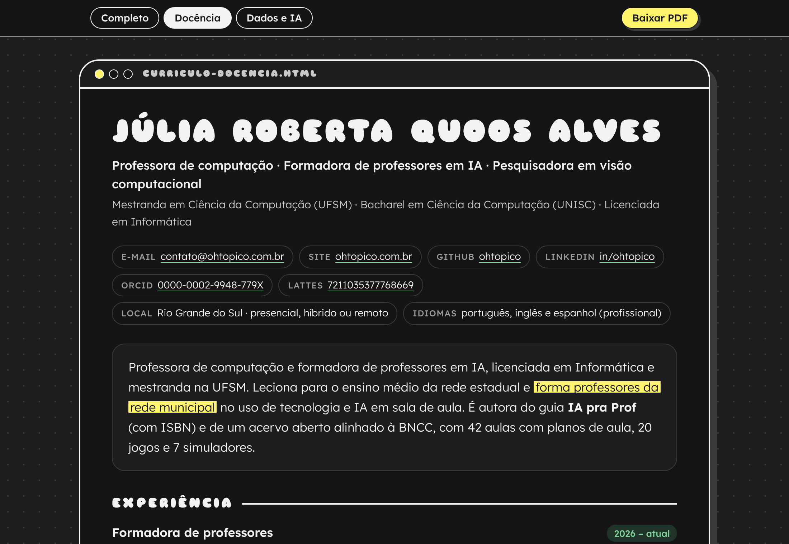
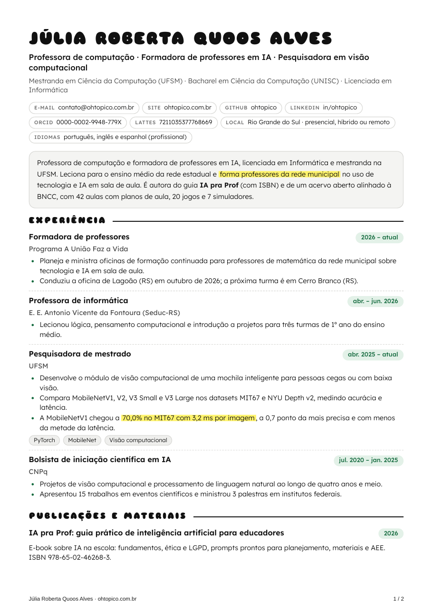

# Currículo em JSON → página web + PDF

Escreva o currículo **uma vez**, em um arquivo JSON, e gere a página web e o PDF.
Dá para ter **versões diferentes para cada tipo de vaga** (por exemplo, docência e dados)
sem copiar e colar: cada item diz em quais versões aparece.



| Modo escuro | PDF (A4) |
|---|---|
|  |  |

## Como usar

Precisa do [Node.js](https://nodejs.org) 18 ou mais novo.

```bash
npm install                        # instala o Playwright, que gera o PDF
npx playwright install chromium    # baixa o navegador usado no PDF (só na primeira vez)
npm run gerar                      # lê curriculo.json e grava tudo em saida/
```

Na pasta `saida/` ficam:

- `index.html` com a primeira versão e uma página para cada outra (`docencia.html`, `dados.html`…);
- um PDF por versão (`seu-nome-docencia.pdf`…), com o botão **Baixar PDF** na página;
- `assets/` com o estilo e as fontes, para a página funcionar sem internet.

Outros comandos:

| Comando | O que faz |
|---|---|
| `npm run web` | gera só as páginas, sem PDF (não precisa do Playwright) |
| `npm run assistir` | gera de novo toda vez que você salva o JSON |
| `node gerar.mjs outro.json --saida pasta` | usa outro arquivo e outra pasta |
| `node gerar.mjs --versao docencia` | gera só uma versão |
| `npm test` | roda os testes |
| `NAVEGADOR=/caminho/do/chrome npm run gerar` | usa um Chrome já instalado no PDF, sem `npx playwright install` |

## O formato do JSON

O [`curriculo.json`](curriculo.json) é um exemplo completo e o
[`exemplos/minimo.json`](exemplos/minimo.json) é o ponto de partida mais curto.
No VS Code, a linha `"$schema"` liga o autocompletar e avisa campos errados
(o esquema está em [`schema/curriculo.schema.json`](schema/curriculo.schema.json)).

```jsonc
{
  "versoes": { "completo": "Completo", "docencia": "Docência" },  // opcional
  "pessoa": {
    "nome": "Seu Nome",
    "titulo": "Professora de computação",
    "contatos": [{ "rotulo": "E-mail", "texto": "voce@exemplo.com", "link": "mailto:voce@exemplo.com" }]
  },
  "resumo": { "completo": "…", "docencia": "…" },   // ou um texto só
  "secoes": [
    { "titulo": "Experiência", "itens": [
      { "titulo": "Cargo", "local": "Escola", "periodo": "2026 – atual",
        "topicos": ["O que fez e o resultado"], "tags": ["Python"],
        "versoes": ["docencia"] }                       // sem "versoes" = aparece em todas
    ]},
    { "titulo": "Formação",     "tipo": "lista",   "itens": [ … ] },
    { "titulo": "Competências", "tipo": "pilulas", "grupos": [{ "titulo": "IA", "itens": ["PyTorch"] }] },
    { "titulo": "Idiomas",      "tipo": "texto",   "texto": "Português · Inglês" }
  ],
  "rodape": { "site": "ohtopico.com.br", "link": "https://ohtopico.com.br" }
}
```

Tipos de seção:

- **`itens`** (padrão): blocos com título, local, período, texto, tópicos, pílulas de ferramentas e link;
- **`lista`**: uma linha por item, boa para formação e cursos;
- **`pilulas`**: grupos de pílulas, bons para competências;
- **`texto`**: um parágrafo.

Dentro dos textos dá para usar `**negrito**`, `==grifo amarelo==` e `[link](https://…)`.
Se faltar algum campo obrigatório, o gerador diz qual é e onde está, em português.

Para usar uma foto, coloque `"foto": "foto.jpg"` em `pessoa`, com o caminho relativo ao JSON.

## Publicar no GitHub Pages

O workflow em [`.github/workflows/publicar.yml`](.github/workflows/publicar.yml) gera a página
e os PDFs a cada push na `main` e publica no GitHub Pages. Para ligar: no repositório,
abra **Settings → Pages** e escolha **GitHub Actions** em *Source*.

## Visual

Segue o estilo de [ohtopico.com.br](https://ohtopico.com.br): títulos em Sniglet, texto em Lexend,
moldura de janela com sombra preta, fundo pontilhado, pílulas e grifo amarelo.
A página tem modo escuro automático, funciona no celular e tem link para pular direto ao conteúdo.
Para mudar as cores, edite as variáveis no começo de [`modelo/estilo.css`](modelo/estilo.css).

## Licença

Código sob a licença MIT. As fontes Sniglet e Lexend seguem a SIL Open Font License 1.1.

Feito por [Júlia Roberta Quoos Alves](https://ohtopico.com.br).
